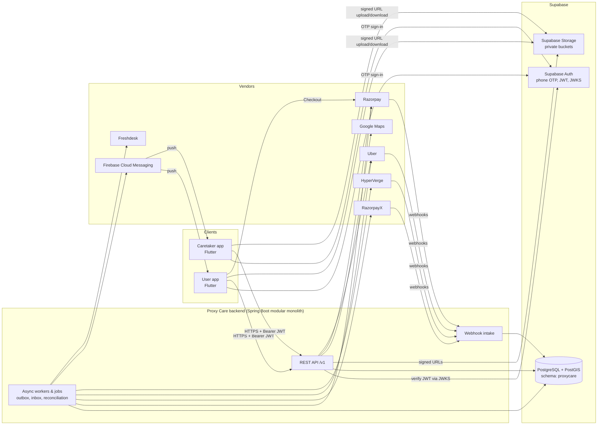

# Proxy Care Backend: Architecture

Status: Milestone 00 baseline, 2026-11-18. No backend code exists yet; this document and the
ADRs in [`adr/`](adr/) define what Milestone 01 onwards will build.

## 1. What the backend does

Proxy Care connects **Users** (sponsors, usually adult children) who need help with a family
member's (**Patient's**) hospital visit to vetted **Caretakers**. One person can hold both the
USER and CARETAKER roles. The backend is the system of record for accounts, patients, bookings,
dispatch, visit progress, rides, hospital bills, payment requests, settlement, caretaker
earnings and payouts, KYC status and notifications.

Inputs to this architecture:

| Source | What it fixes |
|---|---|
| `documents/product-requirement-document.md` (PRD v2.3) | Entities, workflows, pricing, cancellation policy |
| `documents/proxy-care-ui-ux-state-for-api-design.md` | Screens, states, enums, payment-request model |
| `documents/proxy-care-payment-bdd.zip` | Payment, webhook, idempotency and security behaviour |
| `atdd/test-specs/**` | Booking, pickup/ride and hospital acceptance criteria, access control |
| `proxy-care-client/lib/core/**` | Existing API contract: envelope, error codes, headers, pagination, auth |

## 2. System context

- The apps use Supabase **only** for sign-in and for file transfer with URLs the backend signs.
  All business reads and writes go through the API.
- Payments are paid by the user in Razorpay Checkout; the backend creates the order and learns
  the outcome from webhooks plus verification and reconciliation.

## 3. Technology baseline

Details and verification status in [ADR 0001](adr/0001-framework-and-version.md).

| Area | Choice |
|---|---|
| Language / runtime | Java 21 (Temurin), Gradle toolchain |
| Framework | Spring Boot 4.1.x (4.1.2), Spring MVC, Spring Framework 7.0, Spring Security 7.1 |
| Modularity | Spring Modulith 2.1.2, ArchUnit 1.5.1 |
| Persistence | Hibernate 7.4 / Spring Data JPA, `JdbcClient`, Flyway 12.4, PostgreSQL JDBC 42.7, HikariCP 7 |
| JSON | Jackson 3.1 |
| Resilience | Resilience4j 2.4.0 (`resilience4j-spring-boot4`, compatibility check in M01) |
| Rate limiting | Bucket4j 8.22 |
| Scheduling locks | ShedLock 7.11 (compatibility check in M01) |
| Observability | Micrometer 1.17, Micrometer Tracing + OpenTelemetry, Boot structured logging |
| Tests | JUnit 6, AssertJ, Mockito, Testcontainers 2.0 (PostGIS), WireMock, Spring Modulith test |
| Build | Gradle 9.x Kotlin DSL, version catalog, dependency locking |

## 4. Modules

Rules and diagram in [ADR 0002](adr/0002-project-structure.md).

| Module | Owns | Public surface (examples) |
|---|---|---|
| `shared` | Envelope, errors, security plumbing, logging, `Money`, `Clock`, idempotency, outbox config, jobs, integration base, i18n | Open module |
| `identity` | Accounts, roles, status, `/v1/me` | `CurrentUser`, `AccountId`, `RoleGranted` event |
| `integrations` | Vendor clients and signature verifiers | `RazorpayClient`, `RazorpaySignatureVerifier`, … |
| `webhooks` | Inbox, dedup, async dispatch | Typed provider events (`RazorpayPaymentCaptured`, …) |
| `health` | Readiness composition | n/a |
| `booking` *(later)* | Patients link, bookings, services at hospital, cancellation | `BookingId`, booking events |
| `dispatch` *(later)* | Broadcast, first-accept, caretaker availability, live location | dispatch events |
| `ride` *(later)* | Ride legs, ride-partner integration | ride events |
| `billing` *(later)* | Payment requests, payments, refunds, hospital bills | payment events |
| `settlement` *(later)* | Final fee, earnings wallet, withdrawals/payouts, disputes | settlement events |
| `kyc` *(later)* | Caretaker onboarding, KYC, bank verification | KYC events |
| `notification` *(later)* | Device tokens, push fan-out | n/a (listens only) |

Package layout inside every module: `api` (HTTP, internal) → `application` (use cases, ports,
transactions) → `domain` (pure Java) ← `infrastructure` (JPA/JDBC, adapters).

Where the patient live-location and "location" concerns sit (`dispatch` vs a separate
`tracking` module) is decided at the start of the visit-execution milestone.

## 5. Cross-cutting decisions (summary)

| Topic | Decision | ADR |
|---|---|---|
| Database | Supabase Postgres, own non-exposed schema `proxycare`, RLS on with one app-role policy, PostGIS geography | [0003](adr/0003-database-and-migrations.md) |
| Connections | Direct connection (or Supavisor session mode on IPv4-only hosts); never the shared transaction pooler; explicit Hikari settings; TLS verify-full | [0003](adr/0003-database-and-migrations.md) |
| Migrations | Flyway owns the schema; forward-only; expand/contract; separate migrate step in deployed environments; Hibernate `validate` | [0003](adr/0003-database-and-migrations.md) |
| Authentication | Spring Security resource server; Supabase JWKS (ES256); strict `iss`/`aud`/`role`/`exp`; stateless | [0004](adr/0004-authentication-and-authorization.md) |
| Authorization | Roles and account status in the backend DB; per-resource checks in use cases; 404 for resources the caller may not see | [0004](adr/0004-authentication-and-authorization.md) |
| API contract | Client's envelope and 10 error codes; `/v1`; camelCase; paise integers; cursor pagination; OpenAPI committed | [0005](adr/0005-api-and-error-contract.md) |
| Observability | Correlation id filter; JSON logs with no PII/tokens; OTel tracing; Prometheus metrics on management port | [0006](adr/0006-observability.md) |
| Idempotency | `Idempotency-Key` store committed with the business change, plus domain uniqueness, plus vendor idempotency | [0007](adr/0007-idempotency-and-rate-limiting.md) |
| Rate limiting | Edge per-IP + Bucket4j per-account (in-memory, Postgres-backed for money endpoints) | [0007](adr/0007-idempotency-and-rate-limiting.md) |
| Webhooks | Raw-body HMAC verification, inbox with `(provider, event_id)` dedup, fast 2xx, async processing, monotonic handlers | [0008](adr/0008-webhook-and-outbox.md) |
| Outbox | Spring Modulith Event Publication Registry (JDBC), at-least-once listeners, staleness monitor, resubmission job | [0008](adr/0008-webhook-and-outbox.md) |
| Integrations | Ports in features, typed `RestClient` clients in `integrations`, Resilience4j, no blind retries of money calls, reconciliation | [0009](adr/0009-integration-architecture.md) |
| Time | `Clock` bean (UTC), injected everywhere; no `now()` calls outside `shared.time`; business zone Asia/Kolkata via `BusinessTime` ([DATABASE.md](DATABASE.md#time)) | [0002](adr/0002-project-structure.md) |
| Money | `Money` value object: `long` paise, exact arithmetic, explicit rounding, exact allocation, no floating point anywhere ([DATABASE.md](DATABASE.md#money)) | [0002](adr/0002-project-structure.md), [0003](adr/0003-database-and-migrations.md) |

### Concurrency principles

- Every mutable aggregate has optimistic locking (`@Version`); a lost race is 409 `CONFLICT`.
- State transitions that race (first caretaker to accept, payment marked paid by both webhook
  and verify call) are **conditional updates** (`UPDATE … WHERE state = …`) whose row count
  decides the winner. Side-effect events are published only by the winner.
- Queues (`webhook_inbox`, scheduled work) use `FOR UPDATE SKIP LOCKED`; scheduled jobs that
  must run once cluster-wide use ShedLock.
- Transactions are short and never span a vendor call.

## 6. Testing strategy

Database specifics (connections, roles, RLS, migrations, entity conventions): [DATABASE.md](DATABASE.md).

Standards 18 to 20 apply: every production-critical path is tested, tests are deterministic,
no real external services, no disabled checks. The working guide (layout, support code,
conventions, commands) is [TESTING.md](TESTING.md); decisions are in
[ADR 0011](adr/0011-testing-infrastructure.md).

| Level | Scope | Tools | Runs |
|---|---|---|---|
| Unit | Domain objects, value objects (`Money`), pricing/state machines, mappers. Pure Java, no Spring | JUnit 6, AssertJ | Every build |
| Architecture | Module boundaries and the rules in ADR 0002 | Spring Modulith `verify()`, ArchUnit | Every build |
| Web slice | Controllers, validation, envelope, error mapping, security rules | `@WebMvcTest`, MockMvc, signed test JWTs | Every build |
| Module integration | One module with its real database schema; event publication | `@ApplicationModuleTest`, Testcontainers PostGIS, `Scenario` API | Every build |
| Persistence | Every migration, constraints, RLS assertions, repository queries, locking behaviour | Testcontainers PostGIS + Flyway | Every build |
| Integration (vendors) | Clients, adapters, resilience, signature verification | WireMock stubs from vendor-doc fixtures | Every build |
| Concurrency | Races that matter for money and dispatch: parallel requests with the same/different keys, webhook vs verify | Testcontainers + `ExecutorService`/latches, Awaitility | Every build |
| Contract | Response/error JSON exactly as the Flutter client parses it; committed OpenAPI diff | JSON fixtures, springdoc | Every build |
| Acceptance | ATDD/BDD scenarios from `atdd/` and the payment BDD, per feature milestone | JUnit-based scenario tests over the HTTP API (Cucumber optional, decided in the first feature milestone) | Every build |
| Log hygiene | Flows with recognisable fake PII; captured logs must not contain it | Logback list appender | Every build |
| Vendor sandbox | Real sandbox calls | Separate, manual Gradle task | Never in CI |

Determinism rules:

- Time comes from an injected `Clock` (`MutableClock` test fixture); no sleeps; async
  assertions use Awaitility with bounded timeouts.
- JWTs in tests are signed by a key pair generated per test run and served from a stubbed JWKS.
- Random ids that tests assert on come from injected generators.
- Tests are independent of execution order (JUnit random method order enabled).
- Testcontainers are reused within a test run (singleton container), not across runs.

Coverage is reported (JaCoCo) but is not a gate on its own; the gates are the categories above.

**Local prerequisite:** Docker must be running for persistence, module-integration and
concurrency tests. On 2026-11-18 Temurin 21 and Docker Desktop were being installed on the
primary development machine (see the Milestone 00 report).

## 7. Open decisions

These are not decided in the ADRs because they depend on information we do not have. Each
names the milestone it blocks.

| Id | Decision needed | Why it matters | Blocks |
|---|---|---|---|
| U1 | Hosting platform and region (India region expected) | IPv6 egress (direct DB connection), secret store, edge rate limiting, deployment pipeline | M03 (connection mode), deployment |
| U2 | Supabase plan and compute size per environment | Connection limits (pool sizing), IPv4 add-on, dedicated pooler, backups/PITR | M03 |
| U3 | How roles are granted; what a CARETAKER may do before KYC approval | Business rule not in the PRD; must not be invented | M03 (role assignment endpoint), KYC milestone |
| U4 | Back-office/operations access (KYC review, disputes, refunds, support) | Separate auth model, audit requirements | KYC and settlement milestones |
| U5 | Client agreement on `error.reason`, pagination names, idempotent-endpoint list | Contract changes on both sides | M02 |
| U6 | Confirm Supabase projects use asymmetric JWT signing keys (not legacy HS256) | Backend rejects HS256 | M03 |
| U7 | How the API represents a visit date and pickup time. *The business zone itself is settled: Asia/Kolkata (Milestone 03, `BusinessTime`)* | Cancellation policy is measured to pickup time to the minute | Booking milestone |
| U8 | Rate-limit values per endpoint group | Not specified by product | M04 |
| U9 | Observability backend (logs, traces, metrics, alerting) | Export configuration, data-processing review | M02 (export), production readiness |
| U10 | Ride-partner API access (Uber; Rapido mentioned) and contracted HyperVerge products | Feasibility of ride and KYC milestones | Ride and KYC milestones |
| U11 | Data protection: retention periods (webhook payloads, idempotency responses, location history, attachments), consent records, column-level encryption for health notes and KYC data, DPDP Act obligations | Health and identity data | Feature milestones storing such data |
| U12 | PostgreSQL major version of the Supabase projects | Testcontainers image must match | M01 |
| U13 | Reconciliation schedules and alert ownership (BDD marks this pending); duplicate-capture refund policy | Payment correctness after outages | Billing milestone |
| U14 | Timing of the Spring Boot 4.1 → 4.2 upgrade | 4.1 OSS end date to be confirmed on the official calendar | Planned 2027 |

## 8. Implementation sequence

Each milestone ends with its acceptance criteria met, the full test suite green, and a
report (standards: completion rule). A feature milestone does not start until the platform
milestones it depends on are complete.

| # | Milestone | Main content | Depends on |
|---|---|---|---|
| 01 | Build and project skeleton | Gradle wrapper (checksummed), version catalog, locking, Boot 4.1.2 app, `-Werror`, Modulith + ArchUnit rules (passing on an empty module set), Testcontainers PostGIS harness, compatibility smoke tests for Resilience4j / ShedLock / springdoc / WireMock, `backend.yml` CI | M00, U12 |
| 02 | Shared kernel: API, errors, observability | Envelope, exception mapping (all 10 codes), correlation id, structured logging with redaction + log-hygiene tests, `Clock`, `Money`, health/management port, OpenAPI generation and diff gate | 01, U5 |
| 03 | Persistence and identity | Schema/roles runbook, Flyway baseline, Hikari/TLS config, RLS assertions, JWT validation (JWKS, all claim checks, 401 vs 503), account provisioning, roles, status, `/v1/me` | 02, U1, U2, U3 (partly), U6 |
| 04 | Idempotency and rate limiting | `idempotency_record`, claim/complete/replay/takeover with concurrency tests, purge job (ShedLock), Bucket4j limits | 03, U8 |
| 05 | Events, jobs and webhook intake | Modulith event registry (JDBC, ARCHIVE, staleness, resubmission job), ShedLock jobs, `webhook_inbox`, raw-body verification framework, worker with backoff, metrics/alerts | 04 |
| 06 | Integration foundation | `shared.integration` client builder, Resilience4j per vendor, error translation, WireMock harness; first concrete clients: Supabase Storage signed URLs, FCM device-token registration (client endpoint is waiting for it) | 05 |
| 07 | User onboarding and family | Profile (Stage A), patients and relationships (Stage B), address and location capture | 06 |
| 08 | Caretaker onboarding and KYC | Profile, HyperVerge integration, KYC states, RazorpayX bank verification, back-office review | 06, U3, U4, U10, U11 |
| 09 | Booking and booking payment | Booking draft, pricing (paise), Razorpay order + Checkout + verify + webhooks, cancellation quotes and refunds, attachments | 05, 06, 07, U7, U13 |
| 10 | Dispatch | Broadcast to nearby caretakers (PostGIS), first-accept race, assignment, caretaker visit lists | 08, 09 |
| 11 | Visit execution | Pickup OTP, visit stages, live location (visibility matrix), hospital services (start/complete) | 10 |
| 12 | Rides | Ride legs, ride-partner integration and webhooks, own-transport path, ride payment requests | 11, U10 |
| 13 | Hospital bills | QR verification (merchant, MCC), bill payment requests, final bill attachment, disputes | 11 |
| 14 | Settlement and payouts | Audit of open requests, caretaker fee calculation (pending confirmation in the design doc), wallet, RazorpayX payouts, disputes via Freshdesk | 12, 13, U4, U13 |
| 15 | Notifications and production readiness | Notification fan-out across modules, load test and pool sizing, security review, backup/restore drill, runbooks, alerting | all, U9 |

Milestones 07 to 15 will each start with their own scoped plan. Their order may change when
the open decisions are answered.

## 9. ADR index

| ADR | Title |
|---|---|
| [0001](adr/0001-framework-and-version.md) | Framework, language and dependency versions |
| [0002](adr/0002-project-structure.md) | Project structure and module boundaries |
| [0003](adr/0003-database-and-migrations.md) | Database, connections and migrations |
| [0004](adr/0004-authentication-and-authorization.md) | Authentication and authorization |
| [0005](adr/0005-api-and-error-contract.md) | API response and error contract |
| [0006](adr/0006-observability.md) | Logging, tracing and observability |
| [0007](adr/0007-idempotency-and-rate-limiting.md) | Idempotency and rate limiting |
| [0008](adr/0008-webhook-and-outbox.md) | Webhook intake and transactional outbox |
| [0009](adr/0009-integration-architecture.md) | External integration architecture |
| [0010](adr/0010-virtual-threads-and-test-platform.md) | Virtual threads enabled; JUnit Jupiter 6 |
| [0011](adr/0011-testing-infrastructure.md) | Testing infrastructure |

New ADRs use the next number, the same headings (Context, Decision, Alternatives considered,
Consequences) and are never rewritten once accepted: a changed decision gets a new ADR that
supersedes the old one.
