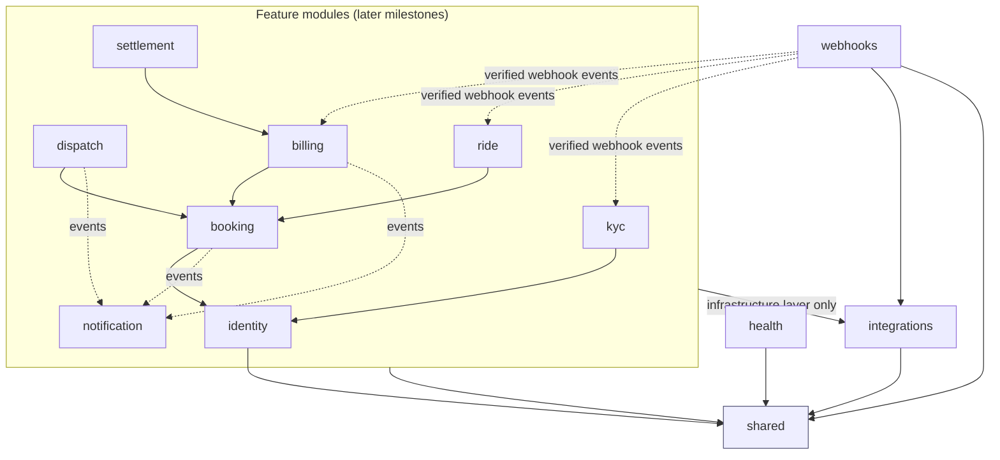

# ADR 0002: Project structure and module boundaries

- Status: Accepted
- Date: 2026-11-18

## Context

The repository is a monorepo. Today it holds the Flutter client (`proxy-care-client/`),
product documents (`documents/`) and acceptance specs (`atdd/`). There is no backend code.

The product has clear sub-domains (identity, booking, dispatch, rides, billing, settlement,
KYC, notifications), but one small team and one database. Splitting into services would add
network failure modes and distributed transactions around money, with no scaling need yet.

## Decision

### Repository layout

```
proxy-care/
├── proxy-care-client/      Flutter apps (existing)
├── proxy-care-backend/     Spring Boot modular monolith (new)
│   ├── docs/               ARCHITECTURE.md, adr/
│   ├── gradle/             wrapper, libs.versions.toml
│   ├── src/main/java/in/proxycare/...
│   ├── src/main/resources/db/migration/   Flyway migrations
│   └── src/test/java/in/proxycare/...
├── atdd/, documents/       (existing)
└── .github/workflows/      backend.yml added, path-filtered to proxy-care-backend/**
```

One Gradle project, one deployable JAR. Modules are Java packages enforced by Spring Modulith
and ArchUnit, not Gradle sub-projects. Gradle sub-projects can be introduced later for a
module that needs compile-time isolation, without changing package names.

### Top-level packages (application modules)

Base package: `in.proxycare`. Each direct sub-package is a Spring Modulith application module.

| Module | Responsibility | Exists from |
|---|---|---|
| `shared` | Technical kernel: API envelope, errors, security plumbing, logging, persistence config, `Money`, `Clock`, idempotency, outbox/event config, jobs, integration base, i18n | Milestone 02 |
| `identity` | Accounts keyed by Supabase user id, roles, account status, `/v1/me` | Milestone 03 |
| `integrations` | Vendor clients (Razorpay, RazorpayX, Google Maps, Uber, HyperVerge, FCM, Freshdesk, Supabase Storage). Transport only, no business meaning | Milestone 06 |
| `webhooks` | Webhook intake: raw-body capture, signature verification, inbox, dispatch | Milestone 05 |
| `health` | Liveness/readiness composition | Milestone 02 |
| `booking`, `dispatch`, `ride`, `billing`, `settlement`, `kyc`, `notification` | Feature modules | Later milestones |

`shared` sub-packages, fixed by the standards: `api`, `error`, `security`, `logging`,
`persistence`, `money`, `time`, `idempotency`, `outbox`, `jobs`, `integration`, `i18n`.

### Layers inside a module

```
in.proxycare.<module>
├── <Module>Api / events / ids       ← module's PUBLIC surface (module root package)
├── api/              REST controllers, request/response records, web mappers   (internal)
├── application/      use cases, transaction boundaries, ports (interfaces)       (internal)
├── domain/           entities, value objects, domain services, domain events     (internal)
└── infrastructure/   JPA/JDBC repositories, port adapters, vendor adapters       (internal)
```

"api" here means the **HTTP** layer, as in the standards. It is internal to the module: no
other module calls a controller.

A module's **public surface** is its root package (Spring Modulith's default): a facade
interface, the domain events it publishes, and identifier value types. Anything else another
module needs is exposed explicitly with `@NamedInterface`.

### Dependency rules

Enforced by `ApplicationModules.of(ProxyCareApplication.class).verify()` (Spring Modulith)
and ArchUnit tests:

1. **Layering inside a module**: `api → application → domain`; `infrastructure → application,
   domain`. `domain` depends on nothing else in the module.
2. **Pure domain**: `..domain..` must not import `org.springframework..`, `jakarta.persistence..`,
   `org.hibernate..`, `tools.jackson..`, `com.fasterxml..`, any `integrations` package or any
   vendor SDK. Allowed: JDK, `in.proxycare.shared.money`, `in.proxycare.shared.time` value types
   (which are themselves pure).
3. **No cycles** between modules (Modulith).
4. **Only public surfaces** may be referenced across modules (Modulith).
5. **`shared` depends on no feature module.** `shared` is declared
   `@ApplicationModule(type = OPEN)` so its sub-packages are usable without listing named
   interfaces; rule 5 plus ArchUnit keep it from becoming a dumping ground.
6. **`integrations` depends only on `shared`.** Feature modules depend on `integrations` from
   their `infrastructure` layer only.
7. **`webhooks` depends on `shared` and `integrations`** (for signature verifiers). It never
   depends on feature modules; features subscribe to its events.
8. **No JPA entity in a controller signature** (ArchUnit: classes annotated `@Entity` must not
   appear as parameter or return types of `@RestController` methods).
9. **Constructor injection only** (ArchUnit: no `@Autowired` fields or setters).
10. **No `java.time` "now" calls** (`Instant.now()`, `LocalDateTime.now()`, …) outside
    `shared.time` (ArchUnit). Code takes an injected `Clock`.
11. **No `float`/`double` fields or parameters** in classes whose name or package mentions
    money, price, fee, amount, payout or settlement (ArchUnit). Money is `Money` (paise, `long`).

### Module dependency diagram



Solid arrows are compile-time dependencies; dotted arrows are asynchronous events (ADR 0008).
The feature-to-feature edges are **provisional**. They are fixed when each feature
milestone starts and are verified by `ApplicationModules.verify()`.

## Alternatives considered

- **Microservices.** Rejected: no independent scaling or team-ownership need; adds
  distributed transactions around payments.
- **Gradle multi-project per module.** Deferred: stronger isolation but more build overhead.
  Modulith + ArchUnit give the same guarantees for a team of this size.
- **Package-by-layer** (`controllers/`, `services/`, `repositories/`). Rejected by the standards.
- **Vendor adapters inside each feature module only** (no `integrations` module). Rejected:
  the same vendor (Razorpay) is used by several features; auth, signing, resilience and error
  translation would be duplicated.

## Consequences

- Architecture tests are part of the normal test suite and fail the build.
- `Documenter` (Spring Modulith) generates module diagrams into `build/` in CI as an
  artifact, so this diagram can be checked against reality.
