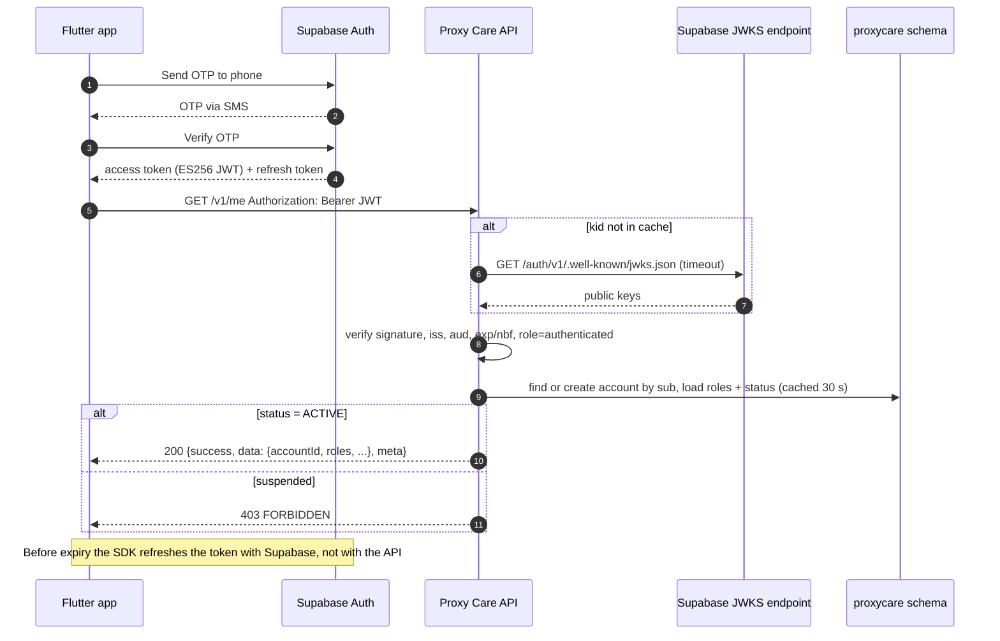

# ADR 0004: Authentication and authorization

- Status: Accepted
- Date: 2026-11-18

## Context

- Users sign in with **Supabase Auth, phone OTP**. The Flutter client holds the Supabase
  session and sends the access token as `Authorization: Bearer <jwt>`.
- Current Supabase projects sign access tokens with **asymmetric keys** (ES256 by default) and
  publish the public keys at `https://<ref>.supabase.co/auth/v1/.well-known/jwks.json`. Older
  projects use a shared HS256 secret; the JWKS is empty for those.
- Supabase also issues JWT-shaped API keys (legacy `anon` and `service_role`). Those must never
  be accepted as user credentials.
- The same person can be both **USER** and **CARETAKER**.
- The client says roles must come from a server-controlled source and "the claim that will
  carry roles is not agreed with the backend yet"
  (`proxy-care-client/lib/core/auth/supabase/supabase_authentication_session.dart`).
- **Decision taken by the user on 2026-11-18: roles are stored in the backend database**, not
  in a Supabase token claim.

## Decision

### Token validation (Spring Security OAuth2 Resource Server)

Stateless (`SessionCreationPolicy.STATELESS`), no cookies, CSRF disabled for the bearer-token
API only (there is no browser session to forge).

`NimbusJwtDecoder.withJwkSetUri(<supabase-url>/auth/v1/.well-known/jwks.json)` with:

| Check | Rule |
|---|---|
| Algorithm | Allow-list from configuration, default `ES256`. **HS256 is rejected**: no shared secret is configured in the backend. If the project still uses legacy HS256 keys, migrating it to signing keys is a prerequisite (U6) |
| `iss` | Equals `<supabase-url>/auth/v1` exactly |
| `aud` | Contains `authenticated` |
| `exp`, `nbf` | Enforced, 30 s clock skew, using the injected `Clock` |
| `role` claim | Equals `authenticated`. Rejects `anon` and `service_role` tokens |
| `sub` | Present and a valid UUID |
| `is_anonymous` | If `true`, rejected (anonymous sign-in is not a product feature) |

- The Supabase URL comes from configuration; there is no default.
- **JWKS caching and rotation**: keys are cached (TTL from configuration, e.g. 10 min) and
  refreshed when a token arrives with an unknown `kid`. A JWKS fetch has its own connect/read
  timeouts. If the JWKS endpoint is down, cached keys keep working; with no cached key the
  request fails with **503 SERVICE_UNAVAILABLE** (not 401: the client would otherwise sign the
  user out for an outage). This distinction gets a dedicated test.
- Failed authentication returns **401 UNAUTHENTICATED** in the standard envelope (ADR 0005)
  with `WWW-Authenticate: Bearer`. The token, its claims and the phone number are never logged.

### Principal and roles

```
JWT (proves identity: sub)  ──►  identity module  ──►  CurrentUser(accountId, authUserId, roles, status)
```

- The `identity` module maps `sub` (Supabase user id) to an **account** row in `proxycare`.
  The first authenticated request for a new `sub` creates the account (`INSERT … ON CONFLICT
  DO NOTHING` then read, so concurrent first requests are safe).
- Roles (`USER`, `CARETAKER`) are rows in `proxycare.account_role`. The JWT carries no roles
  we trust.
- **Account status** (`ACTIVE`, `SUSPENDED`, …) is checked on every request. A suspended
  account gets 403 FORBIDDEN even with a valid token. This is why roles live in the database:
  Supabase access tokens stay valid until they expire (default 1 hour), so revoking access
  must not wait for a refresh.
- Role/status lookup is cached per account for a short TTL (configuration, initial value
  30 s) to avoid one query per request. Revocation therefore takes effect within the TTL; a
  suspension also evicts the local cache entry. With more than one instance, the TTL is the
  upper bound.
- The client gets its roles from `GET /v1/me`, not from the token.
- Only the internal **account id** appears in logs and in other modules. The Supabase `sub`
  and phone number stay inside `identity`.

### Authorization

Two layers, both in the backend:

1. **Coarse (who may call)**: path rules in the `SecurityFilterChain` (authenticated vs
   public) and role checks (`@PreAuthorize("hasRole('CARETAKER')")` or an explicit check at the
   start of the use case).
2. **Fine (which resource)**: in the **application** layer, every use case that loads a
   resource checks the relationship: the booking belongs to this user; this caretaker is
   assigned to this booking; the patient is linked to this user. A resource the caller may not
   see returns **404 NOT_FOUND**, not 403, so ids cannot be probed.

The ATDD access-control features (`atdd/test-specs/*/0*_access_control.feature`) become
integration tests in each feature milestone.

### Public endpoints

Only: `GET /actuator/health/liveness`, `GET /actuator/health/readiness` (on the management
port, see ADR 0006), and `POST /v1/webhooks/{provider}` (authenticated by signature, ADR
0008). Everything else requires a valid token. Deny by default: an unmapped path is
authenticated, then 404.

### CORS

Mobile apps do not need CORS. The web build (GitHub Pages showcase) does not call the API
today. CORS is **disabled** (no allowed origins) until a web client needs it; origins then
come from configuration per environment.

### Sequence



## Alternatives considered

- **Roles in a Supabase custom access-token hook claim.** Rejected (user decision): revocation
  waits for token expiry, and logic is split between a Postgres hook and the backend.
- **Roles from `user_metadata`.** Rejected: users can edit it.
- **Calling Supabase `GET /auth/v1/user` per request.** Rejected: a network call on every
  request; local JWKS verification is the documented approach.
- **HS256 with the legacy JWT secret.** Rejected: a shared secret in the backend can mint
  tokens; rotation requires a redeploy.

## Unresolved (see ARCHITECTURE.md, Open decisions)

- **U3**: How a role is granted. The PRD only says the person chooses USER or CARETAKER at
  onboarding. Whether CARETAKER is granted at sign-up or only after KYC approval (and what a
  caretaker may do before approval) is a business rule that has not been specified.
- **U4**: Back-office/operations access (KYC review, disputes, refunds). Not specified.
- **U6**: Confirm each Supabase project uses asymmetric signing keys.
