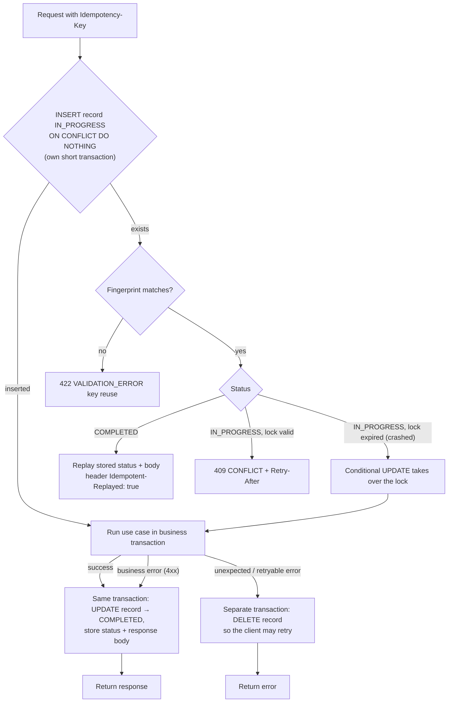

# ADR 0007: Idempotency and rate limiting

- Status: Accepted (rate-limit values and topology unresolved: U1, U8)
- Date: 2026-11-18

## Context

Mobile networks drop responses after the server has acted. The client retries (3 retries with
backoff, `NetworkConfig`) and sends an `Idempotency-Key` header on writes. The payment BDD suite
(`documents/proxy-care-payment-bdd.zip`, feature 21) requires that **no retry, repeat or race
creates a second** order, payment record, capture, refund, payment request, wallet credit or
payout, including five rapid taps, two devices, and the app's verify call racing a webhook.

## Decision

### Idempotency: three layers

Each layer covers a case the others do not:

| Layer | Protects against | Mechanism |
|---|---|---|
| 1. HTTP `Idempotency-Key` | The same client request retried | `shared.idempotency` record store |
| 2. Domain uniqueness | Two *different* requests that mean the same thing (two devices, verify call vs webhook) | Unique constraints and conditional state transitions in the owning module |
| 3. Vendor idempotency | Our own retry of a vendor call creating a second side effect | The vendor's own idempotency mechanism where it exists; otherwise no automatic retry plus reconciliation (ADR 0009) |

Layer 1 alone is **not** sufficient for money. Every money-moving use case must also have a
layer-2 guarantee, which its feature milestone tests with concurrent requests.

### Layer 1: `Idempotency-Key`

- **Which endpoints**: use cases marked idempotent in their web adapter (every POST that creates
  something or moves money, and state-changing actions such as cancel). On those endpoints the
  header is **required**; missing → 400 `VALIDATION_ERROR`. Other endpoints ignore it.
- **Key format**: 8 to 64 characters `[A-Za-z0-9-]` (the client sends a UUID).
- **Scope**: `(account_id, key)`. Keys of different users never collide.
- **Request fingerprint**: SHA-256 of method, route template, path variables and the canonical
  request body. Same key with a different fingerprint → 422 `VALIDATION_ERROR` (key reuse).
- **Storage**: table `proxycare.idempotency_record`:
  `account_id, idem_key, fingerprint, status (IN_PROGRESS | COMPLETED), response_status,
  response_body jsonb, locked_until, created_at, expires_at`, primary key
  `(account_id, idem_key)`.
- **Flow** (in the application layer, not a servlet filter, so completion can join the
  business transaction):

- Because the COMPLETED update commits **in the same transaction** as the business change,
  there is no window where the change is committed but the record says otherwise.
- If the use case also calls a vendor (for example creating a Razorpay order), the vendor call
  happens after the record is claimed; a crash between the vendor call and commit is covered
  by layer 3 and reconciliation, not layer 1.
- Stored responses can contain personal data. Retention: `expires_at` = 24 hours (configurable),
  purged by a scheduled job (ShedLock). The table is never exposed and never logged.

### Layer 2 examples (to be implemented by the owning modules)

- One booking per payment order: unique `(razorpay_order_id)`.
- One `RIDE_TO_HOSPITAL` request per ride: unique `(ride_id, type)`.
- One wallet credit per booking earning: unique `(booking_id, caretaker_id)` on the earning.
- "PAID exactly once": `UPDATE payment_request SET status='PAID' … WHERE id=? AND status IN
  ('REQUESTED','PAYING','FAILED')`, checking the affected row count; side effects are published
  as events only when the row count is 1.

### Rate limiting

- **Two places, two purposes**:
  1. **Edge** (load balancer / CDN / WAF of the hosting platform, U1): coarse per-IP limits
     and request-size limits, before traffic reaches the JVM.
  2. **Application** (`shared.security`, Bucket4j 8.22): per-account, per-endpoint-group
     limits for expensive or abusable operations (payment creation, uploads, withdrawals,
     search). Identified by account id, never by phone number.
- **Storage of buckets**:
  - Initially **in-memory** per instance (Bucket4j core with a bounded Caffeine cache) for
    general limits. With N instances the effective limit is up to N times higher; this is
    acceptable for abuse limits, documented, and revisited when the instance count is known.
  - **PostgreSQL-backed** buckets (`bucket4j_jdk17-postgresql`) only for limits that must be
    exact across instances (withdrawals, payment attempts). Each check is a database round
    trip, so it is not used for every request. The Bucket4j table must live in `proxycare`
    and be created by Flyway, not by the library (verify in the milestone that adds it).
- Exceeding a limit: 429 `RATE_LIMITED` with `Retry-After` (seconds).
- **OTP limits are Supabase's**, configured in the Supabase project (sign-in is not our API).
- **Limit values are not specified** by the product. They are configuration with deliberately
  conservative initial values proposed in the implementing milestone and approved there (U8).
  This ADR does not set them.

## Alternatives considered

- **Idempotency in a servlet filter that caches the HTTP response.** Simpler, but the "done"
  marker would commit separately from the business change; a crash between them causes a
  second execution. Rejected for money-moving endpoints.
- **Redis for idempotency and rate limits.** Not adopted: a new stateful dependency with its
  own outage modes. PostgreSQL is already transactional with our business data, which is the
  property idempotency needs. Revisit if load demands it.
- **Making the key optional everywhere.** Rejected for money-moving endpoints: a client bug
  that drops the header would silently remove protection.

## Consequences

- The Flutter client must send `Idempotency-Key` on every endpoint marked idempotent and reuse
  it across retries of the same user action (it already has the header plumbing).
- Feature milestones carry the obligation to add layer-2 constraints and concurrency tests.
