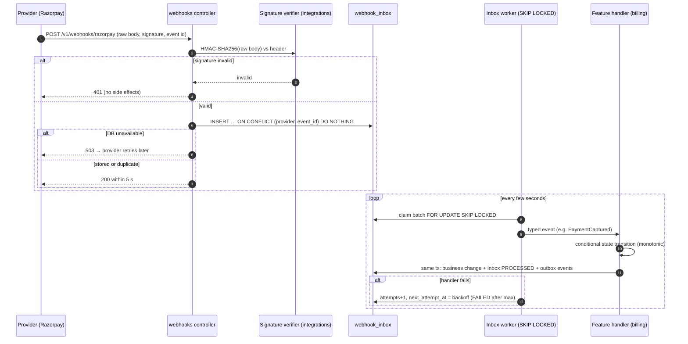
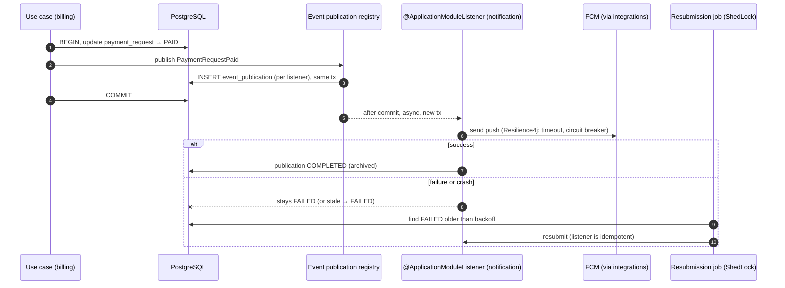

# ADR 0008: Webhook intake and transactional outbox

- Status: Accepted
- Date: 2026-11-18

## Context

### Webhooks

Razorpay (payments, refunds), RazorpayX (payouts), the ride partner and HyperVerge (KYC) notify
us by webhook. The payment BDD (`features/10_razorpay_webhooks.feature`) fixes the behaviour for
Razorpay, and the same rules are sensible for all providers:

- Signature = HMAC-SHA256 of the **raw body** with the webhook secret (`X-Razorpay-Signature`);
  verifying re-serialised JSON must fail.
- `x-razorpay-event-id` is unique per event. Delivery is **at least once and unordered**.
- A non-2xx or a response slower than **5 seconds** is retried for up to 24 hours, after which
  Razorpay disables the webhook.
- Unauthentic requests: rejected, no side effects. Signed but unusable payloads: stored with an
  error, no business change. Unsubscribed types: acknowledged and ignored.
- Same event twice → applied once. Different events describing the same capture → applied
  once. Webhook racing the app's verify call → applied once. Older events must not overwrite a
  newer final state. Database down → non-2xx so the provider retries.
- Missed webhooks are recovered by **reconciliation** against the vendor API.

### Outbox

After a business transaction commits, we often need side effects: push notifications, support
tickets, vendor calls, other modules reacting. Doing them inside the transaction couples it to
slow, failing networks; doing them after commit without a record loses them on a crash.

## Decision: webhooks

`webhooks` module, endpoint `POST /v1/webhooks/{provider}`.

1. **Raw body**: read as bytes before any JSON parsing, with a size cap (configuration,
   initial 1 MB). Spring Security permits this path without a JWT; CSRF does not apply.
2. **Verify**: the provider's verifier from `integrations.<vendor>` computes the HMAC over the
   raw bytes and compares with `MessageDigest.isEqual` (constant time). Secrets come from
   configuration; rotation is supported by accepting a list of active secrets.
   Failure → **401**, nothing stored except a metric and a log line without the body.
3. **Identify**: extract provider event id (header or payload, per provider) and event type.
   A provider without an event id gets a SHA-256 of the raw body as its dedup key.
4. **Store** in `proxycare.webhook_inbox`, in one short transaction:
   `provider, event_id, event_type, payload (text, raw), received_at, status, attempts,
   next_attempt_at, last_error_code, processed_at, correlation_id`, with
   `UNIQUE (provider, event_id)` and `INSERT … ON CONFLICT DO NOTHING`.
   - A duplicate is acknowledged with 2xx and not stored again.
   - Signed but unparseable or unknown-entity payloads are stored as `FAILED` with an error
     code and acknowledged (retrying would not help).
   - Unsubscribed types are stored as `IGNORED` (or only counted; decided per provider).
5. **Acknowledge** with 2xx as soon as the row commits. No business logic runs in the request.
   If the insert fails (DB down), respond **503** so the provider retries.
6. **Process asynchronously**: a worker in `webhooks` claims rows with
   `SELECT … FOR UPDATE SKIP LOCKED` in small batches, parses the payload into a typed,
   provider-specific event record, and publishes it as an application event. The owning
   feature module (`billing`, `ride`, `kyc`, `settlement`) handles it. The inbox row is marked
   `PROCESSED` **in the same transaction** as the handler's business change.
7. **Failure**: the transaction rolls back; a separate update increments `attempts` and sets
   `next_attempt_at` with exponential backoff. After the maximum attempts the row becomes
   `FAILED` and an alert fires. Operators can re-queue it.
8. **Ordering and duplicates by meaning** are the **handler's** job, not the inbox's: handlers
   apply monotonic state machines with conditional updates (a `PAID` request never goes back to
   `PAYING`; `refund.processed` before `refund.created` still ends `processed`). The same
   `UPDATE … WHERE status IN (…)` used by the app's verify call makes the race safe (ADR 0007,
   layer 2).
9. **Retention**: payloads contain personal and payment data. Retention period is unresolved
   (U11); a purge job deletes or redacts payloads after it.

## Decision: transactional outbox

Use **Spring Modulith's Event Publication Registry (JDBC)** as the outbox, rather than a
hand-written outbox table and relay.

- A module publishes a domain event with `ApplicationEventPublisher` inside its transaction.
  The registry writes one publication row **per listener, in the same transaction**
  (Modulith 2.1 docs).
- Listeners are `@ApplicationModuleListener` (async, after commit, own transaction). On success
  the publication is marked `COMPLETED`; on exception it stays incomplete (`FAILED`).
- **Delivery is at least once**, so every listener is idempotent (checks a unique key or a
  state before acting).
- Configuration (`shared.outbox`):
  - `spring.modulith.events.jdbc.schema-initialization.enabled=false`; the publication table
    is created by a Flyway migration in `proxycare`.
  - `completion-mode=ARCHIVE` (completed rows moved to an archive table; purged after a
    retention period) so the live table stays small and history remains queryable.
  - **Staleness monitoring enabled** (`spring.modulith.events.staleness.*`) so publications
    stuck in `PROCESSING` after a crash become `FAILED`.
  - A ShedLock-guarded job resubmits failed publications with `FailedEventPublications`
    (`ResubmissionOptions`: batch size, max in flight, minimum age) on a backoff schedule,
    and raises an alert when attempts exceed a threshold.
  - `republish-outstanding-events-on-restart=false`: with several instances, every restart
    would republish everything; the scheduled job is the single resubmission path.
- **Ordering is not guaranteed.** Listeners must not assume order; where order matters,
  the consumer reads current state instead of trusting event order.
- **Money movement is not driven by generic events alone.** Payouts, refunds and captures are
  explicit records with their own state machines (`REQUESTED → SUBMITTED → PROCESSED/FAILED`)
  owned by their module and advanced by a dedicated job and reconciliation. Events only
  trigger or report those transitions.

## Alternatives considered

- **Synchronous webhook processing.** Rejected: business logic plus vendor calls can exceed the
  5-second window, and a slow DB would make the provider disable the webhook.
- **Hand-written outbox table + relay.** More control over per-message backoff, but it
  duplicates what Modulith 2.x already provides (persistence in the business transaction,
  statuses, attempts, staleness, resubmission). Revisit if per-event backoff or strict ordering
  becomes a requirement.
- **Message broker (Kafka, RabbitMQ).** Rejected for now: a monolith with one database does not
  need one. Modulith's externalization can add one later without changing publishers.
- **Using the Modulith registry for webhooks too.** Rejected: the inbox must dedupe by provider
  event id and keep the raw signed payload, which the registry does not model.

## Consequences

- Two persistent queues exist by design: `webhook_inbox` (inbound, provider-keyed) and the
  event publication registry (internal). Both have backlog/age metrics and alerts (ADR 0006).
- Every listener and webhook handler needs an idempotency test (deliver twice, assert once).
- Reconciliation jobs per provider are required in the feature milestones; they are the
  answer to "Razorpay disabled the webhook" (alert owner and schedule are unresolved in the
  BDD and listed as U13).
